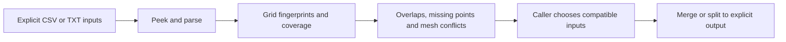

# Campaign Data

[English](README.md) · [简体中文](README.zh-CN.md) · [Computed gallery](docs/assets/showcase/gallery.html) · [Public API](docs/public-api.md)

Understand a directory of CSV/TXT files before merging it. `campaign-data` indexes files, fingerprints parameter grids, reports coverage and overlaps, detects mesh-campaign conflicts, and provides explicit merge/split operations. **Version 0.2.0 · Python 3.10+ · stdlib-only core.**


These are real outputs from three tiny generated CSVs: **24 rows, 3 overlap pairs and 2 mesh conflicts**. Input SHA-256 hashes match before and after the example. [Actual report](docs/assets/showcase/audit-report.txt) · [Source](examples/synthetic_audit.py) · [Provenance](docs/assets/showcase/manifest.json).

## Inspect, audit, then write

| Task | Python API | CLI |
|---|---|---|
| Inspect one file cheaply | `peek_table(path)` | `campaign-data peek file.csv` |
| Read a DataFrame | `read_table(path)` — optional pandas extra | Use Python |
| Audit directory relationships | `audit_directory(path)` | `campaign-data audit data --recursive` |
| Merge compatible inputs | `smart_merge(..., out_path=...)` | `campaign-data merge data --out merged.tsv` |
| Plan and execute splits | `plan_split`, `execute_split` | See `campaign-data --help` |



The first `header_len` columns are grid parameters. Specify this boundary when known; automatic detection is a heuristic. Column meaning, mode identity, registry integration and output ownership remain with callers.

**A conflict means different mesh campaigns share an anchor parameter value.** It is not automatically a contradictory numerical value. Completeness is relative to a file's inferred parameter product, not an external intended scan. The finest-step suggestion in an audit report is a numerical heuristic; it does not settle scientific compatibility.

## Install

Use Python 3.10+ and Git with a pinned public source revision:

```bash
python -m venv .venv
# Activate .venv for your shell, then:
python -m pip install "campaign-data @ git+https://github.com/Patr1ck2005/campaign-data.git@6e95d9de5e814620294143bb365daf1f5187f541"
python -m campaign_data --help
python -m pip check
```

Alternatively install a verified `campaign_data-0.2.0-py3-none-any.whl`. For DataFrames, use `campaign-data[pandas]` with the same source revision or wheel. The core audit example below needs neither pandas nor a plotting library. No package-index release is assumed.

## Runnable synthetic example

```bash
python examples/synthetic_audit.py --out docs/assets/showcase
```

The script creates a coarse scan with one missing grid point, a second coarse scan with one repeated row, and a finer scan. It audits all three, merges only the two compatible coarse files into a separate `merged-coarse.tsv`, verifies unchanged input hashes, and generates four SVGs, a standalone gallery, the actual audit report, a peek summary and a provenance manifest. Everything is generated under the chosen output directory; no private dataset is required.

| Coverage by parameter and file | Completeness and duplicate rows |
|---|---|
|  |  |

[Pairwise overlap view](docs/assets/showcase/overlap.svg) · [Offline gallery](docs/assets/showcase/gallery.html).

## Use your own explicit inputs

```python
from campaign_data import audit_directory, format_audit_report, smart_merge

report = audit_directory("data", header_len=2, recursive=True, use_cache=False)
print(format_audit_report(report))
# Choose compatible files after inspecting the report.
smart_merge(["data/run-a.csv", "data/run-b.csv"],
            out_path="outputs/merged.tsv", header_len=2, use_cache=False)
```

Create the output parent before running the merge. Source file contents are read-only; cache creation is controlled separately by `use_cache`. The example disables caching and uses explicit output paths. The legacy `smart_merge` default can choose a source-directory output when `out_path` is omitted, so supply it deliberately.

`read_table` handles TSV and CSV content, percent-prefixed metadata/header conventions, and numeric conversion; complex/text cells remain strings where appropriate. Simulator meaning and language-specific column mapping remain outside the package.

## Compatibility and development

Plot Workflows 0.1.7's optional `[campaign]` extra requires campaign-data `<0.2`. To use this **0.2.0** reader/audit API, install it independently and do not request that extra. The [four-library example](https://github.com/Patr1ck2005/plot-workflows#run-the-end-to-end-example) follows this separation.

[Public API and safety boundary](docs/public-api.md) · [Changelog](CHANGELOG.md) · [Agent rules](AGENTS.md). In an isolated development environment, install `.[dev]` and run `python -m pytest -q`. Example assertions are a focused demonstration, not a replacement for the package suite.

[Original concept artwork](docs/assets/portfolio/scientific-tools-research-v2.png) and [artwork provenance](docs/assets/portfolio/manifest.json) remain auxiliary illustrations. MIT licensed.
