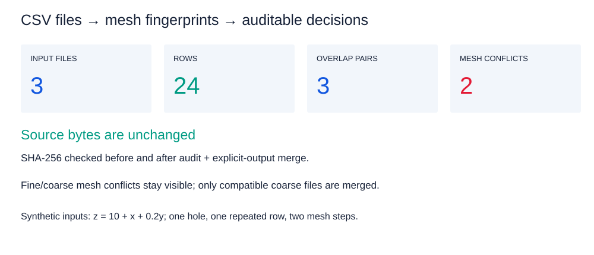
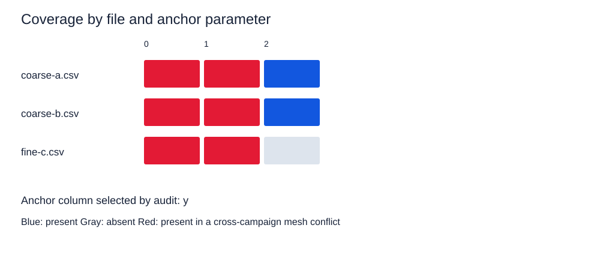
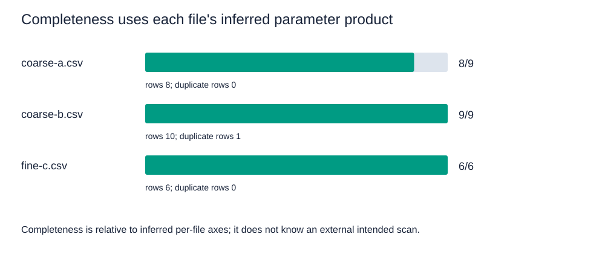

# Campaign Data

[English](README.md) · [简体中文](README.zh-CN.md) · [实际生成的图集](docs/assets/showcase/gallery.html) · [公开 API](docs/public-api.md)

合并前，先理解 CSV／TXT 目录中有什么。`campaign-data` 提供文件索引、参数网格指纹、覆盖率与重叠报告、网格批次冲突检测，以及明确的合并／拆分操作。**版本 0.2.0 · Python 3.10+ · 核心仅依赖标准库。**



图片来自三个小型生成 CSV 的实际运行：**24 行、3 对重叠、2 项网格冲突**。示例运行前后输入 SHA-256 相同。[真实报告](docs/assets/showcase/audit-report.txt) · [源码](examples/synthetic_audit.py) · [来源记录](docs/assets/showcase/manifest.json)。

## 先检查，再审计，再写出

| 任务 | Python API | 命令行 |
|---|---|---|
| 低成本查看单文件 | `peek_table(path)` | `campaign-data peek file.csv` |
| 读取 DataFrame | `read_table(path)`，需要可选 pandas extra | 使用 Python |
| 审计目录关系 | `audit_directory(path)` | `campaign-data audit data --recursive` |
| 合并兼容输入 | `smart_merge(..., out_path=...)` | `campaign-data merge data --out merged.tsv` |
| 规划并执行拆分 | `plan_split`、`execute_split` | 见 `campaign-data --help` |


前 `header_len` 列被视为网格参数。已知边界时请明确提供；自动检测属于启发式。列的物理含义、模式身份、注册表接入与输出归属由调用方负责。

**冲突表示不同网格批次共享某个锚定参数值**，并不自动表示数值互相矛盾。完整度相对于文件中推断的参数笛卡尔积，而非外部预定扫描范围。报告中“保留最细步长”的建议是数值启发式，不能决定科学兼容性。

## 安装

使用 Python 3.10+、Git 与固定的公开源码版本：

```bash
python -m venv .venv
# 按当前 shell 的方法激活 .venv，然后执行：
python -m pip install "campaign-data @ git+https://github.com/Patr1ck2005/campaign-data.git@6e95d9de5e814620294143bb365daf1f5187f541"
python -m campaign_data --help
python -m pip check
```

也可安装已核验的 `campaign_data-0.2.0-py3-none-any.whl`。需要 DataFrame 时，对相同源码版本或 wheel 使用 `campaign-data[pandas]`。下面的核心审计示例不需要 pandas 或绘图库，也不假定存在包索引发行。

## 可运行的合成示例

```bash
python examples/synthetic_audit.py --out docs/assets/showcase
```

脚本创建缺一个网格点的粗扫描、含一行重复数据的第二份粗扫描，以及更细网格的扫描。它审计全部三份文件，仅将兼容的两份粗扫描合并到独立的 `merged-coarse.tsv`，核对输入哈希未变，并生成四张 SVG、独立图集、真实审计报告、预览摘要和来源 manifest。全部内容生成于指定输出目录，不需要私人数据。

| 参数与文件覆盖率 | 完整度与重复行 |
|---|---|
|  |  |

[两两重叠图](docs/assets/showcase/overlap.svg) · [离线图集](docs/assets/showcase/gallery.html)。

## 使用明确的自有输入

```python
from campaign_data import audit_directory, format_audit_report, smart_merge

report = audit_directory("data", header_len=2, recursive=True, use_cache=False)
print(format_audit_report(report))
# 检查报告后选择兼容文件。
smart_merge(["data/run-a.csv", "data/run-b.csv"],
            out_path="outputs/merged.tsv", header_len=2, use_cache=False)
```

合并前创建输出父目录。源文件内容只读；缓存创建由 `use_cache` 单独控制。示例关闭缓存并明确指定输出路径。旧接口 `smart_merge` 在省略 `out_path` 时可能选择源目录内的输出，因此应主动提供路径。

`read_table` 支持 TSV／CSV 内容、百分号元数据／表头约定及数值转换；复数／文本单元格按适用情况保留字符串。仿真器含义和不同语言的列映射留在库外。

## 兼容关系与开发

Plot Workflows 0.1.7 的可选 `[campaign]` extra 要求 campaign-data `<0.2`。需要 **0.2.0** 读取／审计接口时，请独立安装，不请求该 extra。[四库示例](https://github.com/Patr1ck2005/plot-workflows#run-the-end-to-end-example)采用这种分工。

[公开 API 与数据边界](docs/public-api.md) · [变更记录](CHANGELOG.md) · [Agent 规则](AGENTS.md)。开发时在隔离环境中安装 `.[dev]`，运行 `python -m pytest -q`。示例断言是针对性展示，不替代包测试。

[原概念图](docs/assets/portfolio/scientific-tools-research-v2.png)及[图片来源](docs/assets/portfolio/manifest.json)保留为辅助示意。采用 MIT 许可证。
